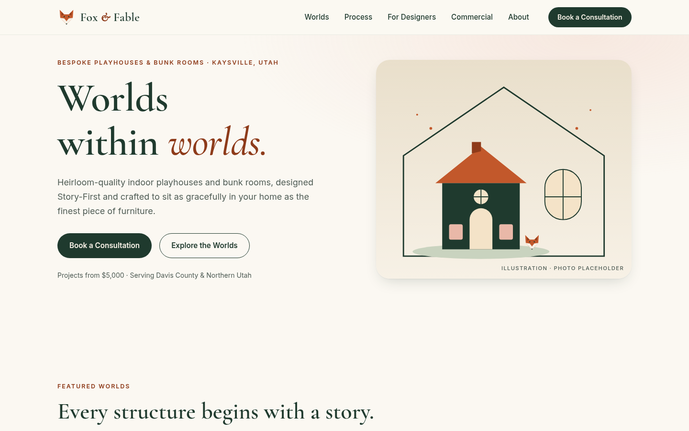

# Fox & Fable · Homepage

A hand-coded, responsive homepage for **Fox & Fable, LLC**, a (concept-stage) boutique design-build studio in
Kaysville, Utah that makes bespoke, heirloom-quality indoor playhouses and bunk rooms.

> **Status:** design mockup / portfolio project. All imagery is illustrated placeholder art, the contact email is a
> placeholder, and the consultation form validates in the browser but does not send anything.



## Features

- **Single-page homepage**: sticky navigation, hero, Featured Worlds, the Story-First Process timeline, values,
  a designer Trade Program, commercial spaces, a Behind-the-Build strip, a consultation form, and a footer.
- **Original inline-SVG illustrations** for each "world" (no stock photos), all labeled as placeholders.
- **Fox logo mark** drawn as an SVG `<symbol>` and reused for the logo, favicon, and illustrations.
- **Mobile navigation** with an accessible toggle (`aria-expanded`; closes on link click, on Escape, and on resize).
- **Client-side form validation** with friendly inline messages, a live character counter, and a success state.
- **SEO**: title and description, canonical link, Open Graph and Twitter card tags, `robots.txt`, `sitemap.xml`.
- **Security hardening**: a strict CSP, security headers, no third-party requests (see [Security](#security)).

## Tech stack

Plain **HTML5, CSS3, and vanilla JavaScript (ES5+)**. No frameworks, build step, or dependencies.

```
site/
├── index.html          # Semantic markup, inline SVG illustrations
├── css/styles.css      # Mobile-first stylesheet built on design tokens
├── js/main.js          # Nav toggle + form validation (no dependencies)
├── assets/
│   ├── fox-mark.svg    # Logo mark
│   ├── favicon.svg, apple-touch-icon.png, og-image.png/.svg
│   └── fonts/          # Self-hosted Cormorant Garamond + Inter (woff2) and their OFL licenses
├── _headers            # Security headers for Netlify / Cloudflare Pages
├── robots.txt, sitemap.xml
├── docs/desktop-hero.png  # README screenshot
├── README.md, SECURITY.md, LICENSE
```

## Design decisions

- **A luxury storybook feel, not a childish one.** The base is deep forest green and cream/ivory, with a warm
  rust ("fox") accent. Sage and blush appear sparingly, nodding to the macaron and nature-inspired palettes
  trending in children's interiors.
- **Typography.** *Cormorant Garamond* (an elegant, bookish serif) for headings and *Inter* for readable body text.
  The heading sizes use `clamp()` so they scale smoothly between phone and desktop.
- **Design tokens.** All colors, type sizes, spacing, radii, and shadows are CSS custom properties in `:root`,
  so the theme can be changed in one place.
- **Layout.** Mobile-first. CSS Grid handles the card grids and split sections, and Flexbox handles the nav,
  buttons, and footer. There are two breakpoints, 720px (tablet) and 1024px (desktop).
- **"Worlds within worlds."** The hero illustration places a small playhouse inside the outline of a family home,
  a visual version of the brand mission.
- **Honest content.** There are no invented testimonials, stats, or awards. Slots for them are clearly marked as placeholders.

## Accessibility notes

- Semantic landmarks (`header`, `nav`, `main`, `section` + `aria-labelledby`, `footer`, `address`) and a logical heading order.
- A **skip link** to the main content, and visible **`:focus-visible`** outlines on every interactive element.
- Meaningful SVGs have a `role="img"` and `<title>`. Decorative SVGs are `aria-hidden="true"`.
- Every form field has a `<label>`, and errors are tied to their fields with `aria-describedby` + `aria-invalid`.
  The form status uses `role="status"`/`aria-live`, and focus moves to the first invalid field.
- Text colors were chosen for **WCAG AA contrast** on their backgrounds (for example, accent text uses `#8E3B1A` on cream).
- Tap targets are at least 44–48px, and the mobile nav button exposes `aria-expanded` and `aria-controls`.
- **`prefers-reduced-motion`** disables smooth scrolling, transitions, and hover lifts.
- Progressive enhancement: without JavaScript the nav stays visible (`.no-js`) and the page stays fully readable.

## Run locally

No build step is needed. Any static server works:

```bash
cd site
python3 -m http.server 8000
# then open http://localhost:8000
```

(Opening `index.html` directly also works, but a local server matches production behavior more closely.)

Optional HTML check:

```bash
npx html-validate index.html
```

## Deploy to GitHub Pages

1. Create a new repository on GitHub (for example `fox-and-fable`) and push this folder:
   ```bash
   git remote add origin https://github.com/<your-username>/fox-and-fable.git
   git branch -M main
   git push -u origin main
   ```
2. On GitHub, open **Settings → Pages**.
3. Under **Build and deployment**, choose **Deploy from a branch**, select `main` and `/ (root)`, then **Save**.
4. Check **Enforce HTTPS** in the same Pages settings.
5. After a minute or two the site is live at `https://<your-username>.github.io/fox-and-fable/`.
6. Before launch, update the `canonical`, `og:url`, and `og:image` URLs in `index.html`, along with `robots.txt` and `sitemap.xml`, to the real domain.

## Security

This is a static site, but it's hardened the way a production marketing site should be:

| Control | Where |
|---|---|
| **Strict Content-Security-Policy**: `default-src 'self'`; scripts, styles, fonts, and images only from `'self'` (plus `data:` images); `object-src 'none'`; `base-uri 'self'`; `form-action 'self'`; `frame-ancestors 'none'`; `upgrade-insecure-requests` | `_headers` (HTTP header) + `<meta http-equiv>` fallback in `index.html` |
| **No inline JS or event handlers.** All behavior lives in `js/main.js`, so the CSP needs no `'unsafe-inline'` | `index.html`, `js/main.js` |
| **Zero third-party requests.** Fonts are self-hosted and there are no CDNs, analytics, or trackers. Any future external resource must use Subresource Integrity + `crossorigin` | `assets/fonts/` |
| **Security headers**: `X-Content-Type-Options: nosniff`, `X-Frame-Options: DENY`, `Referrer-Policy: strict-origin-when-cross-origin`, `Permissions-Policy: camera=(), microphone=(), geolocation=()…`, `Strict-Transport-Security`, COOP/CORP | `_headers` |
| **Referrer policy** meta (`strict-origin-when-cross-origin`) | `index.html` |
| **Safe DOM updates.** User input is only rendered with `textContent`, never `innerHTML` | `js/main.js` |
| **Form hardening**: `maxlength` on all fields, email/tel types and patterns, trimming and control-character stripping, a hidden honeypot field | `index.html`, `js/main.js` |
| **`rel="noopener noreferrer"`** on outbound links | `index.html` |
| **Repo hygiene**: `.gitignore` blocks `.env*`, keys, certificates, and OS files. No secrets or personal data are committed (the email is a placeholder) | `.gitignore` |
| **Disclosure policy** | `SECURITY.md` |

**Hosting notes**

- **Netlify / Cloudflare Pages** read `_headers` automatically, so every header above is sent.
- **GitHub Pages cannot set custom HTTP headers.** The `<meta>` CSP and referrer policy are the fallback there
  (note that `frame-ancestors` and `X-Frame-Options` don't work from a meta tag). Enable **Enforce HTTPS** in Pages settings.
  For full header support, put the site behind Cloudflare or deploy to Netlify or Cloudflare Pages.

**Client-side validation is not security.** It only improves the experience. A real submission must go
through a backend or form service (for example Formspree, Netlify Forms, or a serverless function) that does
**server-side validation and sanitization, rate limiting, and spam protection** (honeypot plus a CAPTCHA such as Turnstile
or hCaptcha), and that sends data only over HTTPS. When that service is added, allow its endpoint in
`form-action` / `connect-src` in the CSP.

## Roadmap

- Replace the illustrated placeholders with professional lifestyle photography (responsive `srcset`, AVIF/WebP, `loading="lazy"`).
- Connect the form to **Formspree** or **Netlify Forms**, adding server-side validation, spam protection, and a confirmation email.
- Project gallery and case-study pages for each world, plus a dedicated Trade Program page.
- Embed the Behind-the-Build videos (with captions) and add an Instagram/Pinterest feed.
- Add privacy policy and terms pages, structured data (`LocalBusiness` JSON-LD in an external file), and a sitemap per page.
- Run automated Lighthouse and axe accessibility checks in CI.

## License

Code is released under the [MIT License](LICENSE) © 2026 Cody Schlawin.
The fonts are licensed separately under the SIL Open Font License (see `assets/fonts/OFL-*.txt`).
"Fox & Fable" name and logo are part of a business concept and are not covered by the MIT license.
