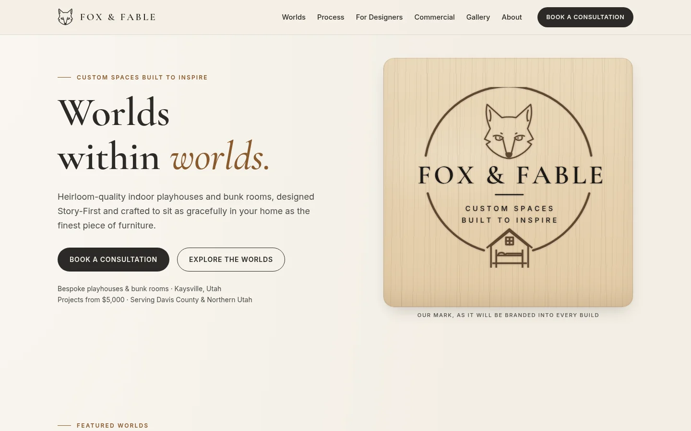

# Fox & Fable · Website

A hand-coded, responsive three-page site for **Fox & Fable, LLC**, a concept-stage design-build studio in
Kaysville, Utah that makes bespoke, heirloom-quality indoor playhouses and bunk rooms.
*Custom Spaces Built to Inspire.*

> **Status:** design mockup / portfolio project. Apart from Cody's headshot, all imagery is placeholder art.
> Bios are fill-in prompts, the contact email is a placeholder, and the consultation form validates in the
> browser but does not send anything.



## Pages

| Page | What's on it |
|---|---|
| `index.html` | Hero with the branded badge, Featured Worlds, Story-First Process, values, designer Trade Program, commercial spaces, Behind-the-Build (painting time-lapse and workshop joinery videos), gallery teaser (Color Drench pantry, daughter's closet, his & her closets), consultation form |
| `about.html` | "Our Story": Jessica's founder section (placeholder bio and portrait), Cody's section (real headshot, placeholder bio and title), the featured family photo plus two family placeholders, brand story and values, consultation CTA |
| `gallery.html` | Nine slots in a row-ordered grid, **finished projects only**: three self-hosted videos (the Color Drench pantry, the daughter's custom closet, his & her closets), then six photo placeholders. Category filters (All / Playhouses / Bunk Rooms / Closets & Built-ins / Commercial) and an accessible `<dialog>` lightbox for photos |

## Features

- **Badge logo recreated as a vector** (`assets/logo-badge.svg`). The ring, fox head, rule, and house are hand-drawn
  SVG paths. The lettering is outlined from the self-hosted OFL fonts by `tools/build-logo.py`, so there's no font
  dependency. It uses `currentColor`, so the same symbol renders as charcoal ink, as a burned-oak "brand" on wood,
  or as parchment on the dark footer.
- **Compact fox mark** (`assets/logo-mark.svg`) for the nav, plus a favicon, apple-touch icon, and Open Graph image built from it.
- **Shared header and footer** on every page, with `aria-current="page"` on the active link.
- **Mobile navigation** with an accessible toggle (`aria-expanded`; it closes on link click, on Escape, and on resize).
- **Client-side form validation** with friendly inline messages, a live character counter, and a success state.
- **Gallery filters and lightbox.** Progressive enhancement: without JS, every project shows and each link opens the full image.
- **Self-hosted project videos** (WebM/VP9 + MP4/H.264) that play inline with native controls. Nothing autoplays, and `preload="none"` means no video bytes load until the visitor presses play.
- **SEO**: a per-page title and description, canonical URLs, Open Graph and Twitter tags, `robots.txt`, and `sitemap.xml`.
- **Security hardening**: a strict CSP, security headers, and no third-party requests (see [Security](#security)).

## Tech stack

Plain **HTML5, CSS3, and vanilla JavaScript**. No frameworks, build step, or runtime dependencies.

```
site/
├── index.html, about.html, gallery.html
├── css/styles.css            # Mobile-first stylesheet built on design tokens
├── js/main.js                # Nav, form validation, gallery filters + lightbox
├── assets/
│   ├── logo-badge.svg        # Full badge logo (vector, currentColor)
│   ├── logo-mark.svg         # Fox head mark
│   ├── favicon.svg, apple-touch-icon.png, og-image.png/.svg
│   ├── fonts/                # Self-hosted Cormorant Garamond + Inter (woff2) + OFL licenses
│   ├── video/                # Self-hosted MP4 (H.264/AAC) + WebM (VP9/Opus) pairs, metadata stripped
│   └── images/
│       ├── placeholders/     # landscape / portrait / square placeholder art
│       ├── about/            # cody.*, family.* (Jessica's portrait goes here)
│       └── gallery/          # video posters + project photos
├── tools/build-logo.py       # Regenerates the logo SVGs (needs: pip install fonttools brotli)
├── tools/sprite.svg.txt      # Generated <symbol> markup pasted into each page's sprite
├── docs/                     # README screenshot + brand reference (original logo artwork), WebP
├── _headers, robots.txt, sitemap.xml
└── README.md, SECURITY.md, LICENSE
```

## Design decisions

- **The palette comes from the branding-iron logo.** Charcoal ink, parchment, oak, and wrought iron. Soft sage and blush
  macaron accents appear only in illustrations and small details.

  | Token | Hex | Use | Contrast |
  |---|---|---|---|
  | `--c-ink` | `#2B2A28` | Text, dark bands | 12.4:1 on parchment, 11.2:1 on parchment-2 |
  | `--c-iron` | `#4A4A48` | Secondary text | 7.7:1 on parchment, 7.0:1 on parchment-2, 5.6:1 on oak band |
  | `--c-parchment` | `#F3EEE4` | Page background, text on charcoal | 12.4:1 on ink |
  | `--c-parchment-2` | `#EAE3D6` | Alternate bands | |
  | `--c-paper` | `#FBF8F2` | Cards, inputs | |
  | `--c-oak` | `#B07A45` | Rules, borders, decorative accents (non-text only) | 3.2:1 on parchment |
  | `--c-oak-deep` | `#8A5A2E` | Accent text (eyebrows, links) | 5.1:1 on parchment, 4.6:1 on parchment-2, 5.5:1 on paper |
  | `--c-oak-dark` | `#6E5034` | Accent text on the oak-grain band | 4.7–5.3:1 |
  | `--c-oak-light` | `#D9B48A` | Accent text on charcoal | 7.4:1 on ink, 8.6:1 on ink-deep |
  | `--c-on-dark` | `#CFC8BC` | Body text on charcoal | 8.6:1 on ink, 10:1 on ink-deep, 7.0:1 on ink-soft cards |

- **Textures are CSS gradients only.** That covers the parchment wash, the oak grain (`--tex-wood`), and the brushed-iron
  bands. They need no image requests, so the CSP stays strict.
- **Typography.** *Cormorant Garamond* for headings and the spaced-caps wordmark (an echo of the badge lettering) and
  *Inter* for body text and the spaced-caps eyebrows (an echo of the badge tagline). Each eyebrow gets a short rule
  like the one under the badge name.
- **"Branded" motif.** The hero shows the badge burned into an oak board, a nod to the custom branding iron the logo was designed for.
- **Honest content.** There are no invented testimonials, stats, awards, projects, or bios. Every slot is labeled as a placeholder.

## Accessibility notes

- Semantic landmarks, one `h1` per page, a logical heading order, and a skip link on every page.
- Visible `:focus-visible` outlines, and tap targets of 44px or more.
- Meaningful SVGs have a `role="img"` and `<title>`. Decorative SVGs are `aria-hidden`. Every photo has `alt` text
  (placeholders say they are placeholders).
- Form labels, `aria-describedby` errors, `aria-invalid`, a live status region, and focus moved to the first error.
- Gallery filters are toggle buttons (`aria-pressed`) with a polite live region announcing the result count.
- The lightbox uses a native modal `<dialog>`, so focus is trapped by the browser. **Esc** closes it, **← / →** navigate,
  and focus returns to the thumbnail that opened it.
- `prefers-reduced-motion` turns off smooth scrolling, transitions, and hover lifts.

## Run locally

```bash
cd site
python3 -m http.server 8000      # then open http://localhost:8000
npx html-validate index.html about.html gallery.html   # optional HTML check
```

## Adding photos

### Privacy first: strip metadata

Phone photos carry **EXIF metadata, including GPS coordinates of where they were taken** (often your home).
This repository is public, so strip metadata from every photo, especially family photos, before committing:

```bash
exiftool -all= -overwrite_original photo.jpg          # https://exiftool.org
# or with ImageMagick:
magick photo.jpg -strip -resize "1600x1600>" -quality 82 photo.jpg
```

Double-check with `exiftool photo.jpg` (it should show no GPS, camera, or date fields).

### About page (`about.html`)

| Slot | Drop the file at | Aspect | Suggested size |
|---|---|---|---|
| Jessica's portrait | `assets/images/about/jessica.webp` (+ `.jpg`) | 4:5 portrait | 640 × 800 |
| Extra family photos (2) | `assets/images/about/family-2.webp`, `family-3.webp` | 1:1 square | 800 × 800 |

Then, in `about.html`:

1. Change the `` from `assets/images/placeholders/…svg` to the new file. Use `<picture>` with a WebP
   `<source>` and a JPEG fallback, following Cody's portrait markup.
2. Update `width`/`height` to the real pixel size. This prevents layout shift.
3. Replace the `alt` with a real description, e.g. `alt="Jessica in the Fox & Fable workshop"`.
4. Delete the `<span class="ph-label">…</span>` line, and replace the `[bracketed]` prompt text and role.

Cody's headshot (`assets/images/about/cody.webp` / `.jpg`, 640 × 800) and the featured family photo
(`assets/images/about/family.webp` / `.jpg`, 557 × 743, 3:4) have light touch-ups only (gentle levels, slight
warmth, light sharpening) and are sRGB. All metadata was stripped. The family photo's alt text doesn't include the children's names. Keep it that way.

### Adding gallery photos (`gallery.html`)

1. Export the photo at about **1600px on the long edge** as **WebP** (or JPEG), strip the metadata (see above), and save it as
   `assets/images/gallery/<project-slug>.webp`.
2. Copy one `<figure class="gallery-item">` block in `gallery.html` and edit it:

   ```html
   <figure class="gallery-item photo ratio-landscape" data-category="playhouses">
     <a class="gallery-link" href="assets/images/gallery/alchemists-attic-farmington.webp">
       
     </a>
     <figcaption><span class="gallery-cat">Playhouse</span> <span class="gallery-meta">The Alchemist's Attic · Storybook loft · Farmington, UT</span></figcaption>
   </figure>
   ```

   - `data-category` is one or more of `playhouses`, `bunk-rooms`, `closets`, `commercial`, separated by spaces. These drive the filter buttons.
   - `ratio-landscape` (4:3), `ratio-portrait` (4:5), `ratio-square` (1:1), or `ratio-reel` (9:16, for vertical phone video) sets the frame shape.
   - The link `href` is what the lightbox shows. Keep it a local file (the lightbox only accepts same-origin URLs).
   - Write descriptive `alt` text: what's in the room, not "photo of project".
   - Remove the `ph-label` span, and delete placeholder blocks as real projects replace them.
3. Ask clients for permission before publishing photos of their home, and never include names or street addresses.

### Adding project videos

Videos are self-hosted in `assets/video/` (the CSP allows `media-src 'self'` only, so there are no YouTube or Instagram embeds).
They play inline and **never open in the lightbox**: the lightbox only picks up items with a `.gallery-link`.

**1. Transcode and strip metadata.** Phone video stores **GPS coordinates** (`com.apple.quicktime.location.ISO6709`),
the device model, and the creation date. Remove all of them:

```bash
# MP4 / H.264 + AAC, long edge 1080px, streamable (+faststart). ffmpeg applies the phone's rotation automatically.
ffmpeg -i input.mov -map 0:v:0 -map 0:a:0 -map_metadata -1 -map_metadata:s:v -1 -map_metadata:s:a -1 -map_chapters -1 \
  -vf "scale='if(gt(iw,ih),1080,-2)':'if(gt(iw,ih),-2,1080)',format=yuv420p" \
  -c:v libx264 -preset slow -crf 25 -profile:v high -c:a aac -b:a 96k \
  -movflags +faststart -fflags +bitexact -flags:v +bitexact -flags:a +bitexact project.mp4
# WebM / VP9 + Opus (smaller in Chrome/Firefox/Edge)
ffmpeg -i input.mov -map 0:v:0 -map 0:a:0 -map_metadata -1 -map_chapters -1 \
  -vf "scale='if(gt(iw,ih),1080,-2)':'if(gt(iw,ih),-2,1080)'" \
  -c:v libvpx-vp9 -crf 34 -b:v 0 -row-mt 1 -c:a libopus -b:a 80k project.webm
# Poster: one sharp frame
ffmpeg -ss 4.8 -i project.mp4 -frames:v 1 -map_metadata -1 project-poster.jpg
# Verify: this should print nothing
ffprobe -v error -show_entries format_tags:stream_tags -of compact project.mp4 | grep -iE 'location|ISO6709|make|model|creation'
```

**2. Add the markup** (copy the Color Drench pantry item in `gallery.html`):

```html
<figure class="gallery-item photo ratio-reel video-item" data-category="closets">
  <video class="gallery-video" controls preload="none" playsinline width="608" height="1080"
         poster="assets/images/gallery/project-poster.webp"
         aria-label="Video: [Theme] [project] built by Fox &amp; Fable">
    <source src="assets/video/project.webm" type="video/webm">
    <source src="assets/video/project.mp4" type="video/mp4">
    <track kind="captions" src="assets/video/project.en.vtt" srclang="en" label="English">
  </video>
  <figcaption>…</figcaption>
</figure>
```

- Don't add `autoplay` or force `muted`. Visitors start playback and control the sound themselves.
- **Captions.** If a video has speech or meaningful sound, add a WebVTT file next to it (`assets/video/<name>.en.vtt`) and
  the `<track>` line above. Same-origin `.vtt` files work under the current CSP. A starter file:
  ```
  WEBVTT

  00:00:00.000 --> 00:00:04.000
  [Describe the speech or sound]
  ```
  The pantry video has no captions file yet. The exact `<track>` line for it is in the HTML comment above its item in `gallery.html`.

The gallery shows **finished projects only**. Process and behind-the-scenes footage goes in the homepage Behind-the-Build strip (`<li class="build-video">`).

**Current videos** (all 608 × 1080 portrait, `controls preload="none" playsinline`, no autoplay):

| File (`assets/video/`) | Where | Notes |
|---|---|---|
| `painting-timelapse` | Homepage Behind-the-Build tile 1 | Spray-painting the fluted pantry doors, sped up 2× to 19.4 s at 30 fps, **no audio** (it was dropped) |
| `custom-pantry` | Gallery, homepage teaser | Finished Color Drench pantry, 9.7 s |
| `daughter-closet` | Gallery, homepage teaser | Custom closet for our daughter, empty → finished reveal, 32.2 s |
| `his-her-closets` | Gallery, homepage teaser | Finished his & her walk-in closets, 12.6 s |
| `workshop-panel-glue-up` | Homepage Behind-the-Build tile 2 (Joinery) | Gluing up and clamping a cabinet panel, 25.3 s |

A time-lapse is made with `-vf "setpts=PTS/2,fps=30,scale=-2:1080" -an` (2× speed; raise the divisor for faster).
Drop the audio, because sped-up sound is unpleasant.

**Privacy.** Never put children's names in captions, alt text, file names, or commits. Before publishing, check the frames
for name signs or decals, house numbers, readable family photos, and faces.

## Deploy to GitHub Pages

1. Create a repository (for example `fox-and-fable`) and push:
   ```bash
   git remote add origin https://github.com/<your-username>/fox-and-fable.git
   git push -u origin main
   ```
2. On GitHub, open **Settings → Pages → Build and deployment**, choose **Deploy from a branch**, then `main` and `/ (root)`, and **Save**.
3. Check **Enforce HTTPS**.
4. The site goes live at `https://<your-username>.github.io/fox-and-fable/`.
5. Before launch, update the `canonical`, `og:url`, and `og:image` URLs in all three pages, plus `robots.txt` and `sitemap.xml`, to the real domain.

## Security

| Control | Where |
|---|---|
| **Strict Content-Security-Policy**: `default-src 'self'`; scripts, styles, fonts, images, and media (video/audio) only from `'self'` (plus `data:` images); `object-src 'none'`; `base-uri 'self'`; `form-action 'self'`; `frame-ancestors 'none'`; `upgrade-insecure-requests` | `_headers` (HTTP) + `<meta http-equiv>` fallback in every page |
| **No inline JS or event handlers.** All behavior lives in `js/main.js`, so there's no `'unsafe-inline'` | all pages |
| **Zero third-party requests.** Fonts are self-hosted and there are no CDNs, analytics, or trackers. Any future external resource must use Subresource Integrity + `crossorigin` | `assets/fonts/` |
| **Security headers**: `X-Content-Type-Options: nosniff`, `X-Frame-Options: DENY`, `Referrer-Policy: strict-origin-when-cross-origin`, `Permissions-Policy` (camera, microphone, geolocation… off), `Strict-Transport-Security`, COOP/CORP | `_headers` |
| **Safe DOM updates.** User input and captions are written with `textContent`, never `innerHTML`. The lightbox only loads same-origin image URLs | `js/main.js` |
| **Form hardening**: `maxlength` on every field, email/tel types and patterns, trimming and control-character stripping, a hidden honeypot | `index.html`, `js/main.js` |
| **`rel="noopener noreferrer"`** on outbound links | all pages |
| **Repo hygiene and privacy**: `.gitignore` blocks `.env*`, keys, and OS files. No secrets are committed. Photo and video metadata (EXIF, QuickTime GPS, device, and dates) is stripped | `.gitignore`, `assets/images/`, `assets/video/` |
| **Disclosure policy** | `SECURITY.md` |

**Hosting notes.** Netlify and Cloudflare Pages read `_headers` automatically. **GitHub Pages cannot set custom
headers**, so there the `<meta>` CSP and referrer policy are the fallback (`frame-ancestors` and `X-Frame-Options`
don't work from a meta tag). Enable **Enforce HTTPS**, or put the site behind Cloudflare for full header support.

**Client-side validation is not security.** A real submission must go through a backend or form service (Formspree,
Netlify Forms, or a serverless function) with **server-side validation and sanitization, rate limiting, and spam protection**
(honeypot plus a CAPTCHA such as Turnstile or hCaptcha), over HTTPS only. When it's added, allow its endpoint in the CSP's
`form-action` / `connect-src`.

## Maintenance notes

- The header, footer, and SVG sprite are repeated in each page, because this is a no-build static site. When you change one, change all three.
- To change the logo, edit `tools/build-logo.py`, run it, then paste `tools/sprite.svg.txt` into each page's sprite.

## Roadmap

- Real project photography (responsive `srcset`, AVIF/WebP), Jessica's portrait, and WebVTT captions for the videos.
- Connect the form to **Formspree** or **Netlify Forms** with server-side validation and spam protection.
- Individual project case-study pages linked from the gallery, and a dedicated Trade Program page.
- Self-host the Behind-the-Build videos (with WebVTT captions), and add privacy policy and terms pages.
- `LocalBusiness` structured data (JSON-LD in an external file), plus Lighthouse and axe checks in CI.

## License

Code is released under the [MIT License](LICENSE) © 2026 Cody Schlawin. The fonts are licensed separately under the
SIL Open Font License (`assets/fonts/OFL-*.txt`). The Fox & Fable name, logo, and photographs are **not** covered by the
MIT license; all rights are reserved.
